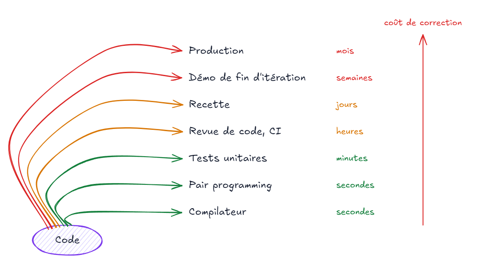
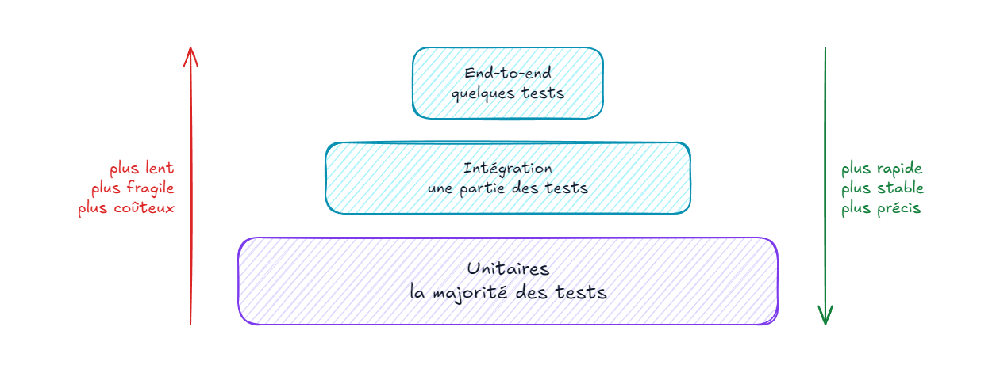
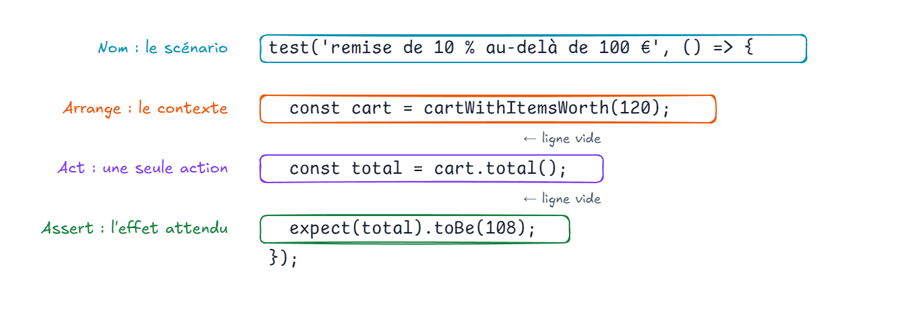

# Fondamentaux des tests unitaires et TDD

---

#### C'est quoi la qualité logicielle ?

Comment définir la qualité d'un logiciel ? 

---

#### Qualité logicielle

- **Fonctionnalité** : faire ce qui est attendu
- **Fiabilité** : le faire sans erreur, dans la durée
- **Maintenabilité** : pouvoir le faire évoluer à coût raisonnable
- **Performance**, **sécurité**, **utilisabilité**…

---

#### Pourquoi s'en préoccuper ?

La qualité ou plus exactement le manque de qualité coute cher en terme d'argent, de réputation, d'ambiance de travail, etc.

---

#### Quels acteurs ?

Même si le code est produit par des développeurs, il est nécessaire de comprendre la qualité logicielle comme un résultat **collectif** nécessitant l'implication et le support de tous les acteurs : du client, au testeur, en passant par le manager jusqu'au développeur.

---

#### Quels leviers ?

La qualité logicielle est une démarche continue propre à chaque contexte passant aussi bien par les processus organisationnels que par les processus opérationnels. Elle peut être, bien entendue, facilité par l'utilisation d'outils adéquats comme des IDEs, des usines logiciels mais est aussi affaire de pratiques, d'apprentissage, d'entrainement et donc de temps de montée en compétences. C'est pourquoi le **Clean Code**, le **Craft**, le **TDD**, le **DDD** sont des boites à outils utiles mais pas auto-suffisantes.

---

#### Un point sur les métriques

La qualité logicielle étant une démarche continue, il est intéressant de pouvoir suivre et mesurer l'évolution de celle-ci au cours du temps via des métriques telles que le code coverage, le pourcentage de duplication, le nombre de ligne de code, etc tout en gardant à l'esprit que ces métriques ne sont pas absolues.

---

#### Boucle de feedback

- Plus la boucle de feedback est **courte**, moins un bug coûte

---

#### C’est quoi un test ?

Action manuelle ou automatisée vérifiant dans un contexte donné qu'un bloc code a les effets attendus au regard d'un exemple d'un concept particulier.

---

#### Pourquoi tester ?

Ecrire des tests automatisés offre plusieurs avantages :

- Valider que le code fait ce que l'on pense
- Faciliter la détection des régressions
- Faciliter le refactoring
- Documenter le comportement attendu par l'exemple

---

#### Le vrai objectif

> Permettre une croissance **durable** du projet logiciel.
>
> — Vladimir Khorikov, *Unit Testing Principles, Practices, and Patterns*

- Sans tests, la vitesse de développement **chute** avec le temps
- Un test a un **coût** : écriture, maintenance, exécution
- Seuls les tests dont la **valeur** dépasse le coût sont utiles
- ⚠️ Un mauvais test est pire que pas de test

---

#### Les familles de tests

---

#### Les familles de tests

- **Unitaire** : une unité de comportement, en isolation, en mémoire
- **Intégration** : plusieurs composants connectés, souvent avec une vraie dépendance (base de données, fichier…)
- **End-to-end** : le système complet, piloté comme un utilisateur (IHM, API)
- Plus on monte : plus de **confiance** sur l'ensemble, mais plus **lent**, **fragile** et **coûteux**
- ⚠️ La taxonomie varie selon les équipes : s'accorder sur un **vocabulaire commun**

---

#### Les propriétés FIRST

- **Fast** : rapide, pour être lancé en permanence
- **Independent** : aucun ordre, aucun état partagé entre tests
- **Repeatable** : même résultat partout, à chaque fois (pas d'horloge, de réseau, de hasard non maîtrisés)
- **Self-validating** : succès ou échec sans interprétation humaine
- **Timely** / **Thorough** : écrit au bon moment, couvre cas nominaux et cas à la marge

---

#### Comment je m’y prends ?

Le pattern des 3A :

- **ARRANGE** : code permettant de mettre en place le contexte pour le code à tester.
    - *Exemple :* Etant donné A égal à 10 et B égal à 2.
- **ACT** : code exécutant l’action qu’on cherche à valider.
    - *Exemple :* Quant on divise A par B.
- **ASSERT** : code vérifiant les effets attendus du code testé.
    - *Exemple :* Alors on doit obtenir 2.

---

#### Pourquoi AAA ?

> Arrange-Act-Assert est un concept simple […] mais il ne coûte rien à pratiquer et offre une façon cohérente de communiquer.
>
> — Tim Ottinger et Jeff Langr

- Pattern nommé par **Bill Wake**
- Le code est surtout **lu** : par les collègues, par soi-même dans six mois
- Repérer les 3 parties d'un coup d'oeil permet de comprendre le test rapidement

---

#### Anatomie d'un test

---

#### Règles d'un test bien structuré

- **Un seul Act** : une ligne, un comportement ; plusieurs actes = plusieurs tests
- **Pas de `if`** ni de boucle dans un test
- **Arrange** souvent le plus long : le factoriser (builders, fonctions)
- **Assert** : plusieurs assertions acceptées si elles décrivent **un même** comportement
- Nommer le résultat `result` / `total` / `sut` pour le repérer

---

#### Ok mais je vérifie quoi ?

La vérification des effets attendus s'effectue des exemples de deux types de cas d'utilisation :

- **Cas nominal** : cas où les exemples d'utilisation correspondent aux cas généraux (happy path).
    - *Exemple :* Prenons le cas de la division, des exemples de cas généraux sont 1/2, 3/7, etc.
- **Cas à la marge** : cas où les exemples d'utilisation correspondent à des erreurs, des exceptions, des cas non généraux.
    - *Exemple :* Prenons le cas de la division, un exemple de cas à la marge est la division par 0.

Dans le cadre des user stories, les ateliers collaboratifs de type [Example Mapping](http://www.les-traducteurs-agiles.org/2017/03/21/presentation-cartographie-des-exemples.html) peuvent être un bon point d'entrée pour définir des exemples concrets de vos critères d'acceptances.

---

#### Les outils nécessaires

- **Bibliothèque de tests** : déclarer des tests et des suites
- **Bibliothèque d'assertions** : exprimer les attendus
- **Test runner** : découvrir, exécuter, rapporter

---

#### À retenir

- Un bon test **protège** des régressions et **résiste** au refactoring
- Structure **AAA**, un seul Act par test, nom **métier**
- **FIRST** : rapides, indépendants, déterministes
- Tester règles métier, validations et **bornes**
