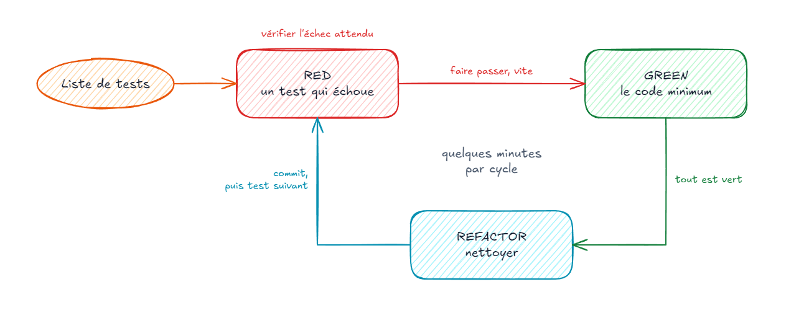

# TDD

---

#### Quand écrire les tests ?

- **Test after** : code d'abord, tests ensuite
  - souvent piloté par la couverture, tests couplés à l'implémentation
  - tests parfois oubliés faute de temps
- **Test first** : tests d'abord, code ensuite
  - l'attendu est clarifié avant l'implémentation
- **TDD** : test first **par petites itérations** avec refactoring systématique

---

#### Le cycle TDD



---

#### Red – Green – Refactor

- 🔴 **Red** : écrire **un** test qui échoue (ou ne compile pas)
  - lire l'échec : **rouge pour la bonne raison** (valeur inattendue plutôt qu'exception)
- 🟢 **Green** : écrire le code **minimum** pour le faire passer, vite
- 🔵 **Refactor** : nettoyer code et tests, sans changer le comportement
- 🔁 Recommencer, par cycles de quelques minutes ; **commit** au vert
- TDD est une technique de **conception** : les tests sont une conséquence

---

#### Les 3 lois du TDD

1. Ne pas écrire de code de production **sans un test qui échoue**
2. Ne pas écrire plus de test que nécessaire pour **échouer** (ne pas compiler compte)
3. Ne pas écrire plus de code de production que nécessaire pour **passer** le test

— Robert C. Martin

---

#### Les patterns du TDD

- **Baby steps** : la plus petite étape possible, surtout quand ça devient difficile
- **Fake it ('til you make it)** : retourner une constante pour passer au vert
- **Triangulation** : ajouter un exemple pour forcer la généralisation
- **Obvious implementation** : écrire directement la solution quand elle est évidente
- 🚦 Revenir aux baby steps dès qu'un test reste rouge trop longtemps

---

#### FizzBuzz : les règles

- Multiple de 3 : `Fizz`
- Multiple de 5 : `Buzz`
- Multiple de 3 et de 5 : `FizzBuzz`
- Sinon : le nombre lui-même

Liste de tests :

- ☐ `1` → `"1"`, `2` → `"2"`
- ☐ `3` → `"Fizz"`, `6` → `"Fizz"`
- ☐ `5` → `"Buzz"`, `10` → `"Buzz"`
- ☐ `15` → `"FizzBuzz"`

---

#### FizzBuzz : itération 1

🔴 **Red**

```ts
import { fizzBuzz } from './fizz-buzz';

it('retourne le nombre lui-même', () => {
  expect(fizzBuzz(1)).toBe('1');
});
```

🟢 **Green** : fake it

```ts
export function fizzBuzz(n: number): string {
  return '1';
}
```

---

#### FizzBuzz : itération 2

🔴 **Red** : triangulation

```ts
it.each([
  [1, '1'],
  [2, '2'],
])('retourne le nombre lui-même : %i', (n, expected) => {
  expect(fizzBuzz(n)).toBe(expected);
});
```

🟢 **Green** : la constante ne suffit plus

```ts
export function fizzBuzz(n: number): string {
  return String(n);
}
```

- Exemples similaires **regroupés** : plus d'exemples aident le lecteur à retrouver la règle

---

#### FizzBuzz : itération 3

🔴 **Red**

```ts
it('retourne Fizz pour 3', () => {
  expect(fizzBuzz(3)).toBe('Fizz');
});
```

🟢 **Green** : minimum, même naïf

```ts {2}
export function fizzBuzz(n: number): string {
  if (n === 3) return 'Fizz';
  return String(n);
}
```

---

#### FizzBuzz : itération 4

🔴 **Red** : triangulation, 3 exemples interdisent un 3ᵉ `if` (règle de trois)

```ts
it.each([3, 6, 9])('retourne Fizz pour un multiple de 3 : %i', (n) => {
  expect(fizzBuzz(n)).toBe('Fizz');
});
```

🟢 **Green**

```ts {2}
export function fizzBuzz(n: number): string {
  if (n % 3 === 0) return 'Fizz';
  return String(n);
}
```

---

#### FizzBuzz : itération 5

🔴 **Red** et 🟢 **Green** : même démarche pour `Buzz`

```ts {3}
export function fizzBuzz(n: number): string {
  if (n % 3 === 0) return 'Fizz';
  if (n % 5 === 0) return 'Buzz';
  return String(n);
}
```

🔵 **Refactor** : révéler l'intention

```ts
const isMultipleOf = (n: number, divisor: number) => n % divisor === 0;
```

---

#### FizzBuzz : itération 6

🔴 **Red**

```ts
it.each([15, 30])('retourne FizzBuzz pour un multiple de 15 : %i', (n) => {
  expect(fizzBuzz(n)).toBe('FizzBuzz');
});
```

🟢 **Green** puis 🔵 **Refactor**

```ts {2}
export function fizzBuzz(n: number): string {
  if (isMultipleOf(n, 15)) return 'FizzBuzz';
  if (isMultipleOf(n, 3)) return 'Fizz';
  if (isMultipleOf(n, 5)) return 'Buzz';
  return String(n);
}
```

---

#### Ce qu'apporte le TDD

- 🎯 **Clarifie** l'objectif avant d'implémenter
- 👣 **Avance** par petits incréments, toujours au vert
- 😌 **Réduit le stress** : une seule chose à la fois, le reste est dans la liste
- ✂️ **Évite** l'over-engineering ; 🧩 **pousse** vers un code découplé
- 🛡️ **Produit** un filet de sécurité et une documentation vivante
- ⚠️ Demande de l'**entraînement** : katas, pair programming

---

#### L'étape Refactor

- Modifier la **structure** sans modifier le **comportement**
- Uniquement **au vert** : les tests sont le filet de sécurité
- Par **petits pas**, en relançant les tests à chaque pas
- Concerne **aussi les tests**
- Supprimer la **duplication**, améliorer la **lisibilité**, traiter les **code smells**

> Always leave the campground cleaner than you found it.
>
> — Boy Scout Rule

---

#### À retenir

- **TDD** : Red – Green – Refactor, petits pas
- Une barre verte est une **permission de penser**
- Tester règles métier, validations et **bornes**
