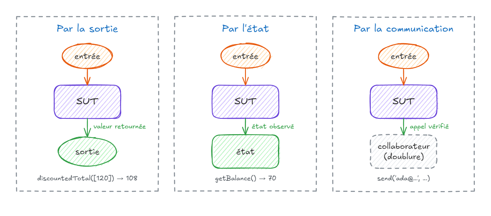
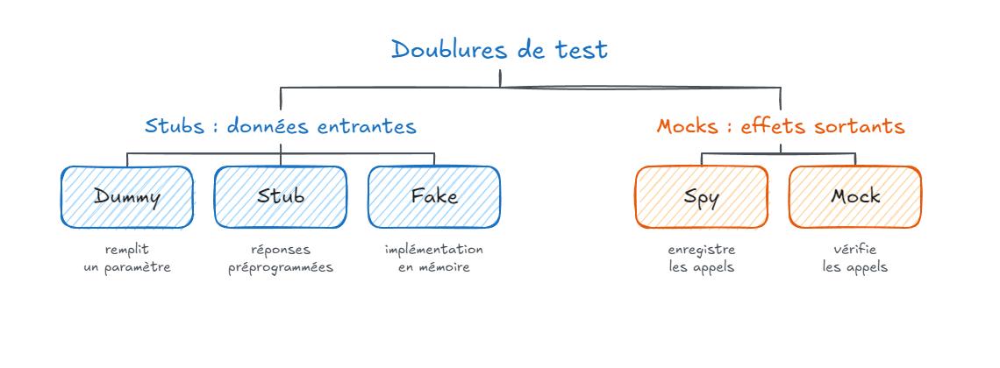
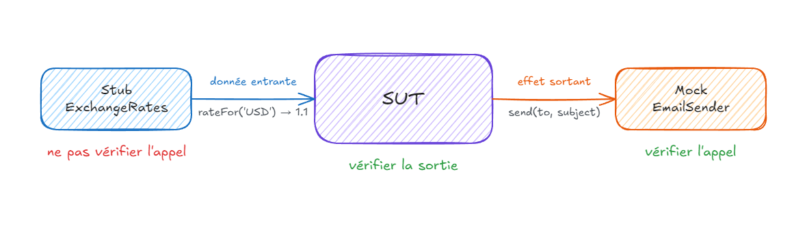
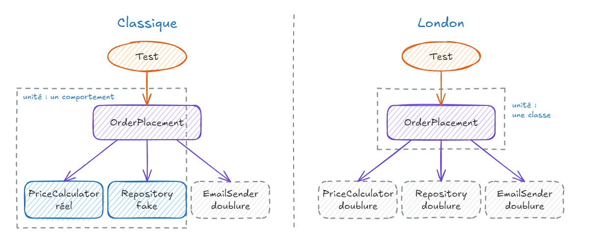

# Mocks, tests avancés 

---

#### Tester les erreurs

- Les erreurs font partie du **contrat** d'une fonction, au même titre que la valeur de retour
- Vérifier **quelle** erreur, pas seulement « ça plante »
- Cas typiques : entrée invalide, règle métier violée, dépendance en échec
- Une erreur non testée finit souvent en **500** en production

---

#### Une erreur métier

```ts
export class InsufficientFundsError extends Error {
  constructor(readonly balance: number, readonly amount: number) {
    super(`Solde insuffisant : ${balance} € pour un retrait de ${amount} €`);
    this.name = 'InsufficientFundsError';
  }
}

export class BankAccount {
  constructor(private balance: number) {}

  withdraw(amount: number): void {
    if (amount <= 0) throw new RangeError('Le montant doit être positif');
    if (amount > this.balance) throw new InsufficientFundsError(this.balance, amount);
    this.balance -= amount;
  }
}
```

---

#### `toThrow`

```ts {4,10}
it('refuse un retrait supérieur au solde', () => {
  const account = new BankAccount(100);

  expect(() => account.withdraw(150)).toThrow(InsufficientFundsError);
});

it('indique le solde dans le message', () => {
  const account = new BankAccount(100);

  expect(() => account.withdraw(150)).toThrow('Solde insuffisant : 100 €');
});
```

- ⚠️ Passer une **fonction** à `expect` : `expect(account.withdraw(150))` lève avant l'assertion
- `toThrow(Classe)`, `toThrow('extrait du message')`, `toThrow(/regex/)`

---

#### Vérifier le contenu de l'erreur

```ts
it('précise le solde et le montant demandé', () => {
  const account = new BankAccount(100);

  expect(() => account.withdraw(150)).toThrow(
    expect.objectContaining({ balance: 100, amount: 150 }),
  );
});

it.each([0, -10])('refuse un montant de %i €', (amount) => {
  const account = new BankAccount(100);

  expect(() => account.withdraw(amount)).toThrow(RangeError);
});
```

- Un type d'erreur par **cas métier** : plus simple à tester et à traiter

---

#### Erreurs asynchrones

```ts
it('refuse de valider un panier vide', async () => {
  const checkout = new Checkout(new StubPaymentGateway());

  await expect(checkout.confirm(emptyCart)).rejects.toThrow(EmptyCartError);
});
```

```ts
// ❌ Sans await : le test se termine avant la promesse et passe quand même
it('refuse de valider un panier vide', () => {
  expect(checkout.confirm(emptyCart)).rejects.toThrow(EmptyCartError);
});
```

- `rejects` / `resolves` + **`await`** (ou `return`)

---

#### Alternative : retourner l'erreur

```ts
type Result<T, E> = { ok: true; value: T } | { ok: false; error: E };

function parseAge(input: string): Result<number, string> {
  const age = Number(input);
  if (!Number.isInteger(age) || age < 0) return { ok: false, error: 'Âge invalide' };
  return { ok: true, value: age };
}

it('refuse un âge négatif', () => {
  expect(parseAge('-3')).toEqual({ ok: false, error: 'Âge invalide' });
});
```

- Erreur **attendue** dans le type de retour : test par la sortie, plus simple
- Exceptions pour l'**inattendu**

---

#### Trois styles de test



---

#### Test par la sortie

```ts
it('applique 10 % de remise au-delà de 100 €', () => {
  expect(discountedTotal([120])).toBe(108);
});
```

- **Output-based** : on fournit une entrée, on vérifie la valeur **retournée**
- Seulement pour du code **sans effet de bord** (fonction pure)
- Le plus **lisible**, le plus **robuste** au refactoring

---

#### Test par l'état

```ts
it('débite le compte du montant retiré', () => {
  const account = new BankAccount(100);

  account.withdraw(30);

  expect(account.getBalance()).toBe(70);
});
```

- **State-based** : on agit, puis on vérifie l'**état** du système ou d'une dépendance
- Lire l'état via l'**API publique**, jamais via un champ privé
- ⚠️ Ne pas exposer d'état **uniquement** pour le test

---

#### Test par la communication

```ts
it('envoie un email de confirmation', () => {
  const emailSender = { send: jest.fn() };
  const orderService = new OrderService(emailSender);

  orderService.confirm(order);

  expect(emailSender.send).toHaveBeenCalledWith('ada@example.com', 'Commande A-42 confirmée');
});
```

- **Communication-based** : on vérifie les **appels** faits à un collaborateur
- Nécessite une **doublure** (ici un mock)
- Utile quand l'appel **est** le comportement attendu (email, paiement, message)

---

#### Quel style préférer ?

| | Sortie | État | Communication |
|:--|:--|:--|:--|
| Résistance au refactoring | ✅ forte | 🟡 moyenne | 🟠 faible |
| Maintenabilité | ✅ peu de setup | 🟡 moyenne | 🟠 doublures à configurer |
| Code concerné | fonctions pures | objets à état | effets de bord |

- Préférer **sortie > état > communication** — Vladimir Khorikov
- Pousser la logique vers du code **pur** pour multiplier les tests par la sortie

---

#### Les dépendances cachées

```ts
export class LunchService {
  isLunchTime(): boolean {
    const hour = new Date().getHours();
    return hour >= 12 && hour < 14;
  }
}
```

- `new Date()` est une dépendance **implicite** et non maîtrisée
- Le test passe à 13 h, échoue à 15 h : **non déterministe**
- Même problème : `Math.random()`, `fetch`, `process.env`, système de fichiers
- Solution : rendre la dépendance **explicite** et **contrôlable** par le test

---

#### Passage par valeur

```ts
export class LunchService {
  isLunchTime(now: Date): boolean {
    const hour = now.getHours();
    return hour >= 12 && hour < 14;
  }
}

it("c'est l'heure du déjeuner à 13 h 30", () => {
  const service = new LunchService();

  expect(service.isLunchTime(new Date(2026, 0, 1, 13, 30))).toBe(true);
});
```

- Le plus **simple** : la fonction devient pure
- La décision remonte à l'appelant

---

#### Passage par fonction

```ts
export class LunchService {
  constructor(private readonly now: () => Date = () => new Date()) {}

  isLunchTime(): boolean {
    const hour = this.now().getHours();
    return hour >= 12 && hour < 14;
  }
}

it("ce n'est pas l'heure du déjeuner à 15 h", () => {
  const service = new LunchService(() => new Date(2026, 0, 1, 15, 0));

  expect(service.isLunchTime()).toBe(false);
});
```

- Léger, **valeur par défaut** pour le code de production

---

#### Passage par contrat

```ts
export interface Clock { now(): Date }

export class LunchService {
  constructor(private readonly clock: Clock) {}

  isLunchTime(): boolean {
    const hour = this.clock.now().getHours();
    return hour >= 12 && hour < 14;
  }
}

const clockAt = (hour: number): Clock => ({ now: () => new Date(2026, 0, 1, hour, 0) });

it("c'est l'heure du déjeuner à 12 h", () => {
  expect(new LunchService(clockAt(12)).isLunchTime()).toBe(true);
});
```

---

#### Surcharge par héritage

```ts
export class LunchService {
  isLunchTime(): boolean {
    const hour = this.now().getHours();
    return hour >= 12 && hour < 14;
  }

  protected now(): Date {
    return new Date();
  }
}

class LunchServiceAt extends LunchService {
  constructor(private readonly fixed: Date) { super(); }

  protected override now(): Date { return this.fixed; }
}
```

- Utile sur du **legacy** (seam), mais couple le test aux détails internes

---

#### Comparatif

| Technique | Quand l'utiliser |
|:--|:--|
| **Valeur** | logique pure, appelant qui connaît la donnée |
| **Fonction** | une seule opération à remplacer |
| **Contrat** (interface) | collaborateur riche, plusieurs implémentations |
| **Héritage** | code legacy, sans toucher la signature |

- Dans tous les cas : **injection de dépendances** plutôt que création interne
- Les dépendances visibles dans le constructeur **documentent** la classe

---

#### Inversion de dépendances

```ts
export interface EmailSender {
  send(to: string, subject: string): Promise<void>;
}

export class OrderService {
  constructor(private readonly emailSender: EmailSender) {}
  // ...
}

// Composition root : seul endroit qui connaît les implémentations
const orderService = new OrderService(new SmtpEmailSender(config.smtp));
```

- **DIP** : le métier dépend d'une **abstraction**, pas de l'infrastructure
- L'abstraction est définie **du point de vue du métier**

---

#### SOLID et testabilité

| Principe | Effet sur les tests |
|:--|:--|
| **S**ingle Responsibility | une raison de changer = moins de cas par classe |
| **O**pen/Closed | ajouter un comportement sans casser les tests existants |
| **L**iskov Substitution | une doublure doit respecter le contrat |
| **I**nterface Segregation | petites interfaces = doublures simples |
| **D**ependency Inversion | dépendances injectables et remplaçables |

- Un code **difficile à tester** révèle souvent un problème de conception

---

#### Cœur fonctionnel, coquille impérative

```ts
// Cœur : logique pure, testée par la sortie
export function shippingCost(order: Order): number {
  if (order.customer.isPremium() || order.total() >= 50) return 0;
  return 4.9;
}

// Coquille : I/O sans logique (humble object), testée en intégration
export async function applyShippingCost(orderId: string, db: Database) {
  const order = await db.loadOrder(orderId);
  await db.updateShippingCost(orderId, shippingCost(order));
}
```

- Isoler les **décisions** des **effets de bord**
- La coquille est si simple qu'elle a peu besoin de tests unitaires

---

#### Pourquoi des doublures ?

- 🐢 **Lent** : base de données, réseau, fichiers
- 🎲 **Non déterministe** : horloge, hasard, service distant
- 🚧 **Indisponible** : API tierce en cours de développement, environnement absent
- 💥 **Effets de bord** : envoi d'email, paiement, message publié
- 🔬 **Cas difficiles à provoquer** : timeout, erreur 503, disque plein

---

#### Les doublures de test



---

#### Les doublures de test

| Doublure | Rôle |
|:--|:--|
| **Dummy** | remplit un paramètre, n'est jamais utilisé |
| **Stub** | fournit des réponses préprogrammées |
| **Spy** | enregistre les appels pour les vérifier ensuite |
| **Mock** | vérifie les appels attendus |
| **Fake** | implémentation simplifiée mais fonctionnelle (en mémoire) |

- Vocabulaire de Gerard Meszaros (*xUnit Test Patterns*)
- `jest.fn()` peut jouer stub, spy ou mock : c'est l'**usage** qui compte

---

#### Dummy et stub

```ts
const dummyLogger: Logger = {
  log: () => { throw new Error('ne doit pas être appelé'); },
};

const stubRates: ExchangeRates = { rateFor: () => 1.1 };

it('convertit un prix en dollars', () => {
  const converter = new PriceConverter(stubRates, dummyLogger);

  expect(converter.toUsd(100)).toBeCloseTo(110);
});
```

- **Dummy** : seulement pour satisfaire la signature
- **Stub** : alimente le SUT en **données entrantes**

---

#### Spy et mock

```ts
class EmailSenderSpy implements EmailSender {
  readonly sent: { to: string; subject: string }[] = [];

  async send(to: string, subject: string) {
    this.sent.push({ to, subject });
  }
}

it('envoie un email de confirmation', async () => {
  const emailSender = new EmailSenderSpy();

  await new OrderService(emailSender).confirm(order);

  expect(emailSender.sent).toEqual([{ to: 'ada@example.com', subject: 'Commande A-42 confirmée' }]);
});
```

- Vérifie les **interactions sortantes** ; avec Jest : `jest.fn()` + `toHaveBeenCalledWith`

---

#### Fake

```ts
export class InMemoryOrderRepository implements OrderRepository {
  private readonly orders = new Map<string, Order>();

  async save(order: Order): Promise<void> {
    this.orders.set(order.id, order);
  }

  async findById(id: string): Promise<Order | undefined> {
    return this.orders.get(id);
  }
}
```

- Se comporte **comme le vrai**, sans base de données
- Réutilisable dans de nombreux tests, **sans configuration**
- À maintenir : tester le fake et le vrai avec les **mêmes tests** de contrat

---

#### Mock ou stub ?



---

#### Ne jamais vérifier un stub

```ts
it('convertit un prix en dollars', () => {
  const rateFor = jest.fn().mockReturnValue(1.1);
  const converter = new PriceConverter({ rateFor }, dummyLogger);

  expect(converter.toUsd(100)).toBeCloseTo(110);
  // ❌ Détail d'implémentation : la sortie suffit
  expect(rateFor).toHaveBeenCalledWith('USD');
});
```

- Un stub sert à **alimenter** le SUT, pas à le vérifier
- Vérifier un appel entrant = **surspécification** : le test casse au refactoring
- Vérifier les appels **sortants** qui ont un effet visible de l'extérieur

---

#### Jest : configurer une doublure

```ts
const rateFor = jest.fn((currency: string) => 1);

rateFor.mockReturnValue(1.1);
rateFor.mockReturnValueOnce(0.9);
rateFor.mockImplementation((currency) => (currency === 'USD' ? 1.1 : 0.85));

const fetchRate = jest.fn(async (currency: string) => 1);

fetchRate.mockResolvedValue(1.1);
fetchRate.mockRejectedValueOnce(new Error('Service indisponible'));
```

- `mockReturnValue` : toujours ; `…Once` : au prochain appel seulement
- `mockResolvedValue` / `mockRejectedValue` : promesses

---

#### Jest : vérifier les appels

```ts
expect(emailSender.send).toHaveBeenCalled();
expect(emailSender.send).toHaveBeenCalledTimes(1);
expect(emailSender.send).toHaveBeenCalledWith('ada@example.com', expect.stringContaining('A-42'));
expect(paymentGateway.refund).not.toHaveBeenCalled();

expect(emailSender.send.mock.calls).toEqual([['ada@example.com', 'Commande A-42 confirmée']]);
```

- **Matchers asymétriques** : `expect.any(Date)`, `expect.stringContaining(…)`,
  `expect.objectContaining({ … })`
- Vérifier **juste ce qui compte** pour le comportement

---

#### Jest : `spyOn`

```ts
it('génère un code promo à 6 caractères', () => {
  const random = jest.spyOn(Math, 'random').mockReturnValue(0.42);

  const code = generateCouponCode();

  expect(code).toHaveLength(6);
  random.mockRestore();
});
```

- Remplace une méthode d'un **objet existant**, sans changer le code de production
- `mockRestore()` remet l'original (ou `restoreMocks: true` dans la config)
- Utile pour du code **non injectable** ; sinon préférer l'injection

---

#### Jest : `jest.mock`

```ts
import { sendEmail } from './mailer';
import { confirmOrder } from './order';

jest.mock('./mailer');

it('envoie un email de confirmation', async () => {
  jest.mocked(sendEmail).mockResolvedValue();

  await confirmOrder({ id: 'A-42', customerEmail: 'ada@example.com' });

  expect(sendEmail).toHaveBeenCalledWith('ada@example.com', 'Commande A-42 confirmée');
});
```

- Remplace **tout un module** par des `jest.fn()` automatiques
- ⚠️ Couple le test au **chemin d'import** : préférer l'injection quand c'est possible

---

#### Jest : fake timers

```ts
beforeEach(() => jest.useFakeTimers());
afterEach(() => jest.useRealTimers());

it('relance le paiement après 5 secondes', () => {
  const retryPayment = jest.fn();

  scheduleRetry(retryPayment);
  jest.advanceTimersByTime(5000);

  expect(retryPayment).toHaveBeenCalledTimes(1);
});
```

- `advanceTimersByTime` : exécuter les `setTimeout` / `setInterval` sans attendre
- `jest.setSystemTime(date)` : fixer `new Date()` et `Date.now()` pour du code non injectable

---

#### Jest : nettoyer entre les tests

| Option | Effet |
|:--|:--|
| `mockClear()` / `clearMocks` | efface les appels enregistrés |
| `mockReset()` / `resetMocks` | idem + supprime les implémentations |
| `mockRestore()` / `restoreMocks` | idem + restaure l'original (`spyOn`) |

```js
// jest.config.js
module.exports = { preset: 'ts-jest', clearMocks: true, restoreMocks: true };
```

- Sans nettoyage, les appels d'un test **fuient** dans le suivant

---

#### Aide-mémoire

| Besoin | Jest | Sinon |
|:--|:--|:--|
| Créer une doublure | `jest.fn()` | `sinon.stub()` / `sinon.spy()` |
| Valeur de retour | `mockReturnValue(v)` | `.returns(v)` |
| Promesse | `mockResolvedValue(v)` | `.resolves(v)` |
| Remplacer une méthode | `jest.spyOn(obj, 'm')` | `sinon.stub(obj, 'm')` |
| Vérifier un appel | `toHaveBeenCalledWith(…)` | `sinon.assert.calledWith(…)` |
| Horloge | `jest.useFakeTimers()` | `sinon.useFakeTimers()` |

- Java : **Mockito** ; Python : **unittest.mock** ; mêmes concepts

---

#### Deux écoles



---

#### Deux écoles

| | Classique (Detroit) | London (mockist) |
|:--|:--|:--|
| Unité | un **comportement** | une **classe** |
| Isolation | des **tests** entre eux | de la classe et de ses **collaborateurs** |
| Doublures pour | dépendances partagées, hors processus | tout collaborateur mutable |
| Style dominant | sortie, état | communication |
| Conception | souvent inside-out | outside-in |
| Références | Kent Beck, Vladimir Khorikov | Freeman et Pryce (*GOOS*) |

---

#### École classique

```ts
it('confirme la commande et prévient le client', async () => {
  const repository = new InMemoryOrderRepository();
  const emailSender = new EmailSenderSpy();
  const service = new OrderPlacement(repository, new PriceCalculator(), emailSender);

  await service.place('A-42', 'ada@example.com', [{ label: 'Clavier', price: 120 }]);

  expect(await repository.findById('A-42')).toMatchObject({ total: 108 });
  expect(emailSender.sent).toHaveLength(1);
});
```

- Vrais collaborateurs en mémoire (`PriceCalculator`), fake pour le stockage
- Doublure seulement pour l'**effet externe** (email)

---

#### École London

```ts
it('enregistre la commande au prix calculé', async () => {
  const repository = { save: jest.fn(), findById: jest.fn() };
  const calculator = { total: jest.fn().mockReturnValue(108) };
  const emailSender = { send: jest.fn() };
  const service = new OrderPlacement(repository, calculator, emailSender);

  await service.place('A-42', 'ada@example.com', [{ label: 'Clavier', price: 120 }]);

  expect(repository.save).toHaveBeenCalledWith(expect.objectContaining({ total: 108 }));
});
```

- Chaque collaborateur est une doublure : on teste **une classe** et ses échanges
- Guide la conception des **interfaces** par l'usage

---

#### Forces et faiblesses

| | Classique | London |
|:--|:--|:--|
| ✅ | résistant au refactoring | échec localisé précisément |
| ✅ | tests proches du métier | setup simple, conception guidée |
| ⚠️ | un bug peut rendre rouges plusieurs tests | tests couplés à l'implémentation |
| ⚠️ | setup parfois plus lourd | refactoring = tests à réécrire |

- Pas de dogme : choisir **en conscience**, souvent un mélange des deux

---

#### Quand utiliser un mock ?

| Dépendance | Exemple | Dans les tests |
|:--|:--|:--|
| En mémoire | `PriceCalculator`, entités | **réelle** |
| Hors processus, **gérée** | base de l'application | réelle (intégration) ou **fake** |
| Hors processus, **non gérée** | SMTP, bus, API de paiement | **mock** |

- **Gérée** : seule l'application y accède, ses interactions sont un détail d'implémentation
- **Non gérée** : visible par d'autres systèmes, ses interactions font partie du **contrat**
- — Vladimir Khorikov

---

#### Les signes du sur-mocking

- Le setup des mocks est **plus long** que le test
- Le test **répète** l'implémentation, appel par appel
- Un refactoring sans changement de comportement **casse** des tests
- Des mocks qui retournent des mocks
- Tous les tests passent… et l'application est **cassée**
- 💡 Ne mocker que les types **qu'on possède** : envelopper les SDK tiers dans un adaptateur

---

#### À retenir

- Tester les **erreurs** comme une sortie : type, message, `rejects` avec `await`
- Préférer **sortie > état > communication**
- Rendre les dépendances **explicites** et injectables
- **Stub** pour les entrées, **mock** pour les effets sortants vers l'extérieur
