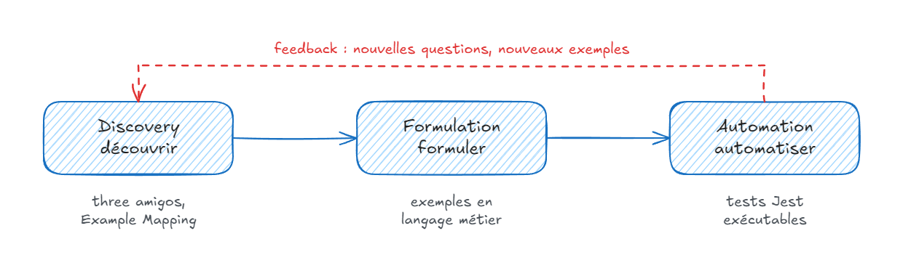
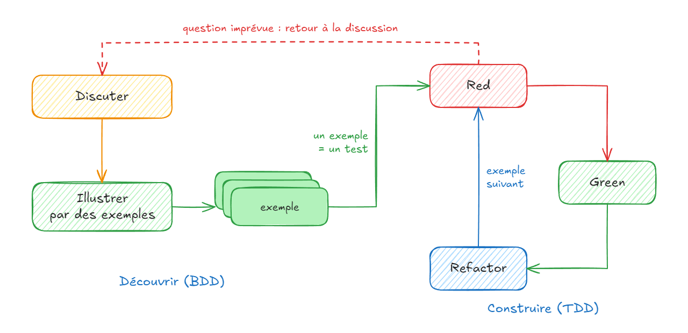
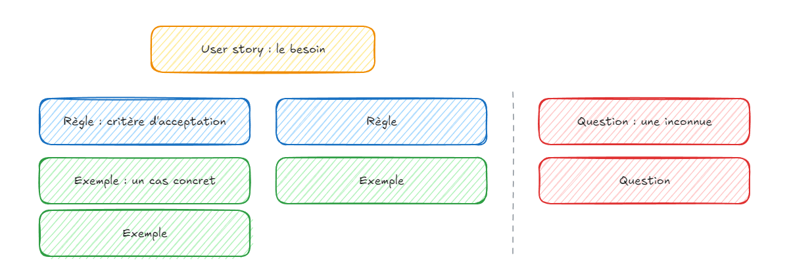
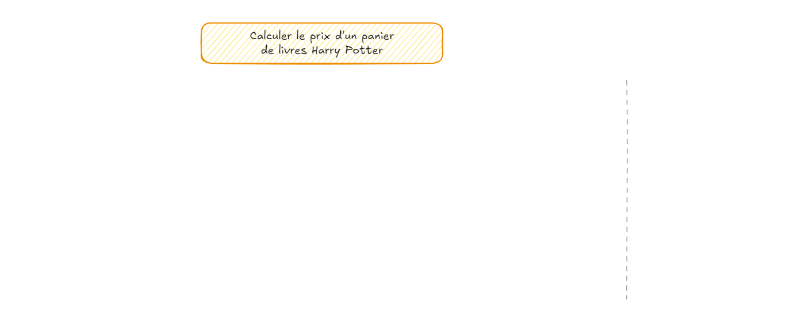
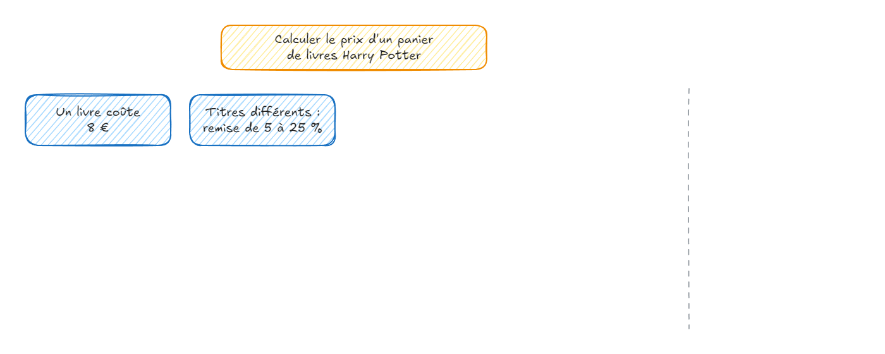
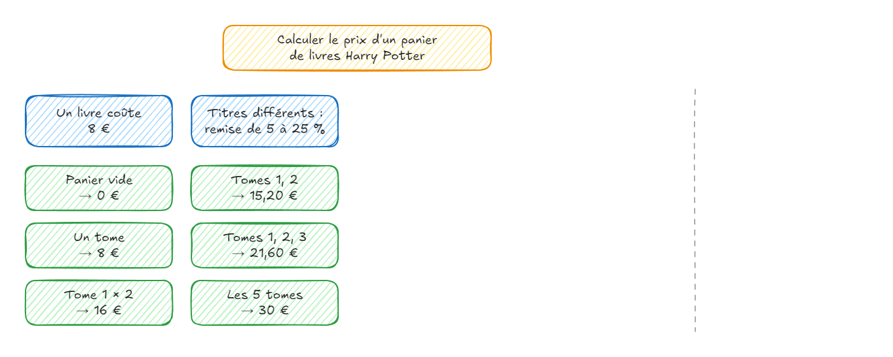
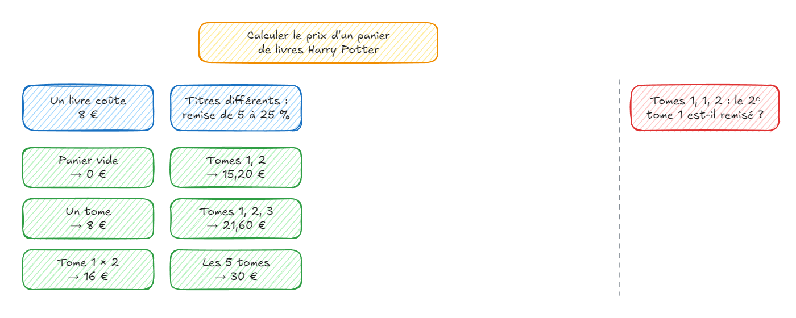
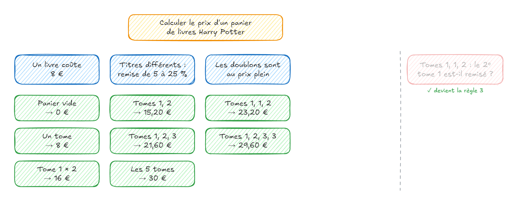
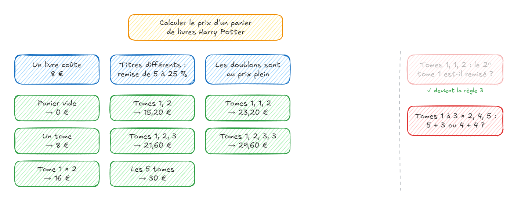

# Behavior-Driven Development

---

#### Implicite et inconnu

> "La livraison est offerte pour les grosses commandes."

- À partir de **quel montant** ?
- Avant ou après les **remises** ?
- Pour **tous les clients** ?
- Et pour un **panier vide** ?

⚠️ Deux développeurs peuvent écrire des tests verts... et livrer deux comportements **différents**

---

#### La démarche BDD

- **Behavior-Driven Development** : Dan North, 2006, issu du TDD
- Une **compréhension partagée** des comportements métier
- Des **exemples** concrets pour lever les ambiguïtés avant de coder
- **Faire évoluer** ensemble logiciel, tests et compréhension

---

#### Les trois pratiques



- **Discovery** : comprendre le besoin ensemble, par des exemples
- **Formulation** : écrire les exemples en langage métier, ici dans les noms des tests
- **Automation** : exécuter les exemples comme tests

---

#### Gherkin n'est pas le BDD

> « Si vous pensez que Cucumber est un outil de test, lisez la suite : vous vous trompez. »
>
> — Aslak Hellesøy, créateur de Cucumber

- **BDD** : une démarche de **collaboration**, s'accorder sur des exemples avant de coder
- **Gherkin** : un **format texte** (`Étant donné… Quand… Alors…`) pour formuler ces exemples
- **Cucumber**, SpecFlow, Behave : des outils pour **automatiser** des fichiers Gherkin
- Le format et l'outil sont **optionnels**, la conversation ne l'est pas

---

#### La conversation d'abord

> « Le BDD, c'est aider les clients, les parties prenantes, à avoir une conversation légèrement structurée avec l'équipe de livraison. »
>
> — Dan North, 2009

| Pratique | Résultat |
|:--|:--|
| Gherkin écrit seul, pour scripter des tests d'IHM | de l'**automatisation de tests** |
| Exemples découverts ensemble, en langage métier | du **BDD**, avec ou sans Gherkin |

- Dans ce module : exemples, Example Mapping et Jest, **sans** Gherkin

---

#### Changer d'état d'esprit

| Point de vue | Question | Nom du test |
|:--|:--|:--|
| Technique | Quelle **méthode** tester ? | 🚫 `shippingCost returns 4.9` |
| Comportement | Dans cette **situation**, que doit-il se passer ? | ✅ `facture 4,90 € pour un panier de 30 €` |

- Le test décrit un **comportement**, pas une méthode
- Le mot "test" s'efface au profit de **comportement** et d'**exemple**

---

#### Le comportement, vu de l'extérieur

Un **contexte**, une **action**, un **résultat observable** :

> Pour un client standard dont le panier vaut 30 €, calculer les frais de livraison donne 4,90 €.

- Observable depuis l'**API publique** de l'unité, même sans interface utilisateur
- Une **valeur retournée**, un **changement d'état** ou un **refus**
- Une unité de comportement peut mobiliser **plusieurs objets**
- Le test reste vrai si l'**implémentation** change

---

#### BDD et TDD se complètent



- Les exemples disent **quoi** construire ; la boucle TDD, **comment**, par petits pas
- Une question imprévue ramène à la **discussion**

---

#### BDD et tests unitaires

- Une **règle métier en mémoire** : le terrain des tests unitaires
- Les exemples deviennent des tests dans le **framework habituel** : Jest, sans outil supplémentaire
- La même démarche guide aussi les **tests d'acceptance**

⚠️ Un test unitaire ne prouve pas que le **parcours complet** fonctionne

---

#### Given / When / Then

| BDD | AAA | Exemple |
|:--|:--|:--|
| **Given** : étant donné | Arrange | un client standard, un panier de 30 € |
| **When** : quand | Act | on calcule les frais de livraison |
| **Then** : alors | Assert | ils valent 4,90 € |

- Même structure que **AAA**, vocabulaire orienté **comportement**
- Une phrase lisible par le **métier**

---

#### Un test orienté comportement

```ts
describe('Frais de livraison', () => {
  describe('pour un client standard', () => {
    it('facture 4,90 € pour un panier de 30 €', () => {
      const order = { customer: 'standard' as const, total: 30 };

      const cost = shippingCost(order);

      expect(cost).toBe(4.9);
    });
  });
});
```

- `describe` : la **fonctionnalité**, puis le **contexte** (Given)
- `it` : l'**action** et le **résultat** attendus (When / Then)

---

#### Des exemples concrets

```ts
describe('pour un client standard', () => {
  it('facture 4,90 € juste sous le seuil, à 49,99 €', () => {
    expect(shippingCost({ customer: 'standard', total: 49.99 })).toBe(4.9);
  });

  it('offre la livraison à partir de 50 €', () => {
    expect(shippingCost({ customer: 'standard', total: 50 })).toBe(0);
  });
});
```

- **Données réelles** : des montants qui révèlent les **bornes**
- Un test par **exemple**, nommé avec les **mots du métier**

---

#### Le rapport comme spécification

```bash
npx jest --verbose
```

```text
Frais de livraison
  pour un client standard
    √ facture 4,90 € pour un panier de 30 €
    √ facture 4,90 € juste sous le seuil, à 49,99 €
    √ offre la livraison à partir de 50 €
  pour un client premium
    √ offre toujours la livraison
```

- Le rapport **se lit** comme les règles métier
- **Documentation vivante** : un écart avec le code rend un test rouge

---

#### Écrire des tests orientés comportement

- **Un contexte** par `describe`, **un exemple** par `it`
- Les **mots du domaine** dans les noms et dans le code (ubiquitous language)
- Aucun détail technique dans le nom : ni méthode, ni classe, ni mock
- **L'essentiel** : retirer tout ce qui n'illustre pas la règle
- Pas plus de **2–3 niveaux** de `describe`

---

#### Des scénarios BRIEF

| Lettre | Dans un test Jest |
|:--|:--|
| **B**usiness language | les mots du domaine dans `describe`, `it` et le code |
| **R**eal data | des valeurs concrètes qui révèlent les bornes : 49,99 € / 50 € |
| **I**ntention revealing | le comportement attendu : ni méthode, ni classe, ni mock |
| **E**ssential | retirer tout ce qui n'illustre pas la règle |
| **F**ocused | une seule règle par test |
| **B**rief | court : quelques lignes |

- Conçu pour les scénarios Gherkin, valable pour tout exemple : tests, cartes 🟩

— Seb Rose et Gáspár Nagy, *The BDD Books – Formulation*

---

#### Trois points de vue

| Point de vue | Question utile |
|:--|:--|
| Métier / produit | Quel résultat apporte de la valeur ? |
| Développement | Quelles distinctions changent le comportement ? |
| Test / qualité | Quel exemple contredit notre interprétation ? |

- Les **three amigos** : des perspectives, pas forcément trois personnes
- Les **mêmes mots** dans la conversation et dans les tests
- Une incertitude devient une **question explicite**, pas une règle inventée

---

#### Règle, exemple, question

| Élément | Illustration |
|:--|:--|
| **Besoin** | Connaître les frais de livraison avant de commander |
| **Règle** | Un client standard paie 4,90 € sous 50 € d'achat |
| **Exemple** | Client standard, panier de 30 € → frais de 4,90 € |
| **Question** | Le seuil s'applique-t-il avant ou après remise ? |

- Une règle **généralise** ; un exemple donne des **valeurs concrètes**
- Sans résultat attendu partagé, il reste une **question**

---

#### L'atelier Example Mapping

- Proposé par **Matt Wynne** (Cucumber), 2015
- Atelier court : environ **25 minutes** par user story
- Les **three amigos** autour d'une table, des cartes de **4 couleurs**
- But : découvrir les **règles** et les **exemples** avant de coder
- Résultat : une story **prête** ou des **questions** à lever

---

#### Les quatre cartes



- Chaque **règle** forme une colonne avec ses **exemples** ; les **questions** restent à part

---

#### Déroulé de l'atelier

1. Poser la 🟨 **story** et la lire à voix haute
2. Énoncer les 🟦 **règles** connues, une carte par règle
3. Illustrer chaque règle par des 🟩 **exemples** concrets
4. Noter chaque doute sur une 🟥 **question**, sans bloquer l'atelier
5. Une question tranchée devient une **règle** ou un **exemple**
6. Conclure : story prête, à découper ou à reporter ?

---

#### Lire la table

- Beaucoup de 🟥 : la story n'est **pas prête**
- Beaucoup de 🟦 : la story est **trop grosse**, la découper
- Une 🟦 sans 🟩 : règle encore **floue**
- 🟩 → les **tests** ; 🟦 → les `describe`
- 🟥 restantes → à poser à la **bonne personne** avant de coder

---

#### Kata Potter : le besoin

- Une librairie vend les **5 tomes** d'une série, **8 €** l'unité
- Une remise s'applique à chaque lot de tomes **différents** :

| Tomes différents | 2 | 3 | 4 | 5 |
|:--|:--|:--|:--|:--|
| Remise | 5 % | 10 % | 20 % | 25 % |

- Objectif : calculer le **prix d'un panier**
- Point de départ : cet énoncé, avec ses **zones d'ombre**

---

#### Example Mapping : Kata Potter



- 🟨 La **story** : le besoin, en une phrase

---

#### Example Mapping : Kata Potter



- 🟦 Les **règles** évidentes, énoncées par le métier

---

#### Example Mapping : Kata Potter



- 🟩 Des **exemples** concrets, calculés ensemble : 2 × 8 € × 0,95 = 15,20 €

---

#### Example Mapping : Kata Potter



- 🟥 Un panier avec un **doublon** : l'énoncé ne dit pas s'il est remisé

---

#### Example Mapping : Kata Potter



- La réponse du métier devient une **règle**, avec ses exemples : 15,20 € + 8 € = 23,20 €

---

#### Example Mapping : Kata Potter



- Le testeur cherche un **contre-exemple** : deux regroupements possibles
- 5 + 3 : 30 € + 21,60 € = **51,60 €** ; 4 + 4 : 25,60 € × 2 = **51,20 €**

---

#### Example Mapping : Kata Potter


- Le métier tranche : le regroupement **le moins cher** pour le client
- Une question reste **ouverte** : elle ne bloque pas la story

---

#### De la carte aux tests

```ts
describe("Prix d'un panier de livres", () => {
  describe('un livre coûte 8 €', () => {
    it.todo('panier vide : 0 €');
    it.todo('un tome : 8 €');
  });

  describe('les doublons sont au prix plein', () => {
    it.todo('tomes 1, 1 et 2 : 23,20 €');
  });

  describe('le regroupement le moins cher est retenu', () => {
    it.todo('tomes 1 à 3 en double, tomes 4 et 5 : 51,20 €');
  });
});
```

- 🟦 → `describe`, 🟩 → `it` ; `it.todo` : la liste de tests, implémentée ensuite en TDD

---

#### À retenir

- **BDD** : une compréhension partagée du comportement, par des **exemples** concrets
- Un test unitaire BDD : **contexte**, **action**, **résultat observable**, en langage métier
- **Example Mapping** : story, règles, exemples, questions, en 25 minutes
- Les exemples deviennent la **liste de tests** du TDD
