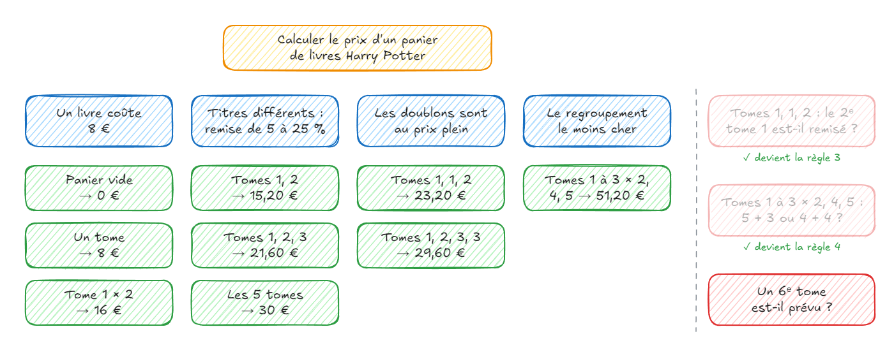

# Exercice 04 — Kata Potter en BDD et TDD

## Objectifs

- Passer d'un **Example Mapping** à des **tests unitaires orientés comportement**.
- **Formuler** les règles et les exemples de la carte dans les noms des tests, avec les **mots du métier**.
- **Automatiser** ces exemples un par un en **TDD** (Red → Green → Refactor).
- Revenir à la **discussion** quand une question imprévue apparaît.

> Pas de Gherkin ni de Cucumber : les exemples deviennent des tests dans le framework de test habituel de votre langage.

## Temps indicatif

1 h à 1 h 30.

## Rappel : de la carte aux tests

| Carte de l'Example Mapping | Dans les tests                                            |
|----------------------------|-----------------------------------------------------------|
| 🟨 Story                   | le groupe de tests principal : la **fonctionnalité**      |
| 🟦 Règle                   | un groupe de tests (`describe`, classe…) par règle        |
| 🟩 Exemple                 | un test par exemple, avec des **données réelles**         |
| 🟥 Question                | pas de test : une question à poser au **métier**          |

Un bon exemple est **BRIEF** :

| Lettre                    | Signification                                                          |
|---------------------------|------------------------------------------------------------------------|
| **B**usiness language     | les mots du domaine (tome, panier, remise…) dans les noms et le code   |
| **R**eal data             | des valeurs concrètes qui révèlent les règles : `tomes 1, 1 et 2 : 23,20 €` |
| **I**ntention revealing   | le comportement attendu : ni méthode, ni classe, ni détail technique   |
| **E**ssential             | retirer tout ce qui n'illustre pas la règle                            |
| **F**ocused               | une seule règle par test                                               |
| **B**rief                 | court : quelques lignes                                                |

## Le besoin

- Une librairie vend les **5 tomes** d'une série, **8 €** l'unité.
- Une remise s'applique à chaque lot de tomes **différents** :

| Tomes différents | 2   | 3    | 4    | 5    |
|------------------|-----|------|------|------|
| Remise           | 5 % | 10 % | 20 % | 25 % |

- Objectif : calculer le **prix d'un panier**.

## L'Example Mapping

Voici la carte obtenue en atelier avec le métier :

🟨 **Story** : calculer le prix d'un panier de livres Harry Potter.

| 🟦 Règle                                 | 🟩 Exemples                                                                      |
|------------------------------------------|----------------------------------------------------------------------------------|
| Un livre coûte 8 €                       | panier vide → 0 € · un tome → 8 € · tome 1 × 2 → 16 €                            |
| Titres différents : remise de 5 à 25 %   | tomes 1, 2 → 15,20 € · tomes 1, 2, 3 → 21,60 € · les 5 tomes → 30 €              |
| Les doublons sont au prix plein          | tomes 1, 1, 2 → 23,20 € · tomes 1, 2, 3, 3 → 29,60 €                             |
| Le regroupement le moins cher            | tomes 1 à 3 × 2, tomes 4 et 5 → 51,20 €                                          |

🟥 **Question ouverte** : un 6ᵉ tome est-il prévu ? Elle ne bloque pas la story : **on ne la code pas**.

## Choix du langage

Choisissez **un** langage et suivez le `README.md` de son dossier `starter` :

| Langage    | Dossier              | Bibliothèque de test |
|------------|----------------------|----------------------|
| Java       | `java/starter`       | JUnit 5              |
| Python     | `python/starter`     | pytest               |
| TypeScript | `typescript/starter` | Jest                 |
| JavaScript | `javascript/starter` | Jest                 |

Le projet `starter` contient une fonction `price` (non implémentée) qui reçoit la liste des tomes du panier, par leur numéro, et retourne le prix en euros. Par exemple, `price([1, 1, 2])` doit retourner `23.20`.

Le dossier `solution` contient une correction possible. Ne la consultez qu'à la fin !

## Étapes

### Étape 1 — Relire la carte (~10 min)

Le testeur cherche les trous de la carte. Relisez-la avec ce regard :

- Chaque remise du tableau est-elle illustrée par **au moins un exemple** ?
- S'il manque un exemple, **calculez-le** (comme en atelier : 2 × 8 € × 0,95 = 15,20 €) et ajoutez-le à la règle concernée.

> Si une nouvelle question apparaît (pendant cette étape ou plus tard), notez-la sur une 🟥 carte et posez-la au **formateur**, qui joue le rôle du métier. N'inventez pas la règle !

### Étape 2 — Formulation : la liste de tests (~10 min)

Traduisez la carte en tests **en attente** (voir la cheat sheet de votre langage) :

- 🟨 la story → le groupe de tests principal ;
- 🟦 chaque règle → un groupe de tests ;
- 🟩 chaque exemple → un test **en attente**, nommé avec les mots du métier.

Ne mettez **aucun nom de méthode** ni détail technique dans les noms des tests.

✅ **Attendu :** les tests s'exécutent, tous **en attente**, et le rapport se lit comme la carte.

### Étape 3 — Automation, règle 1 : un livre coûte 8 € (~10 min)

Activez les exemples **un par un** : écrivez le corps du test (Given / When / Then), vérifiez qu'il est **rouge**, faites-le passer au **vert**, puis refactorez.

### Étape 4 — Règle 2 : titres différents, remise de 5 à 25 % (~15 min)

> 💡 Les prix sont des nombres décimaux : comparez-les avec une **tolérance** (voir la cheat sheet). 16 × 0,95 ne vaut pas exactement 15,2 en virgule flottante !

### Étape 5 — Règle 3 : les doublons sont au prix plein (~15 min)

### Étape 6 — Règle 4 : le regroupement le moins cher (~20 min)

C'est la règle la plus difficile. Pour le panier « tomes 1 à 3 en double, tomes 4 et 5 », deux regroupements sont possibles :

- 5 + 3 tomes : 30 € + 21,60 € = **51,60 €** ;
- 4 + 4 tomes : 25,60 € × 2 = **51,20 €**.

Le métier a tranché : on retient le regroupement **le moins cher** pour le client.

> 💡 Votre code actuel calcule-t-il 51,60 € ? C'est normal : l'exemple joue son rôle de **contre-exemple**. Faites-le passer, puis profitez du filet de sécurité des tests pour refactorer.

✅ **Attendu :** tous les exemples sont **verts**.

### Étape 7 — Bilan (~10 min)

1. Lancez les tests en mode **détaillé** (voir la cheat sheet) et lisez le rapport : se lit-il comme la carte ? Pourrait-on le montrer au métier ?
2. Relisez vos tests avec la grille **BRIEF**. Un nom de test contient-il un détail technique ?
3. Quelles questions sont apparues pendant le TDD ? Qui pouvait y répondre ?
4. Comparez votre code avec le dossier `solution`.

### Pour aller plus loin (bonus)

- [ ] Jouez le testeur : trouvez un **autre panier** où le regroupement le moins cher n'est pas le plus évident, calculez-le à la main et ajoutez-le comme exemple de la règle 4.
- [ ] Si vous utilisez git, faites un **commit à chaque exemple vert**.
