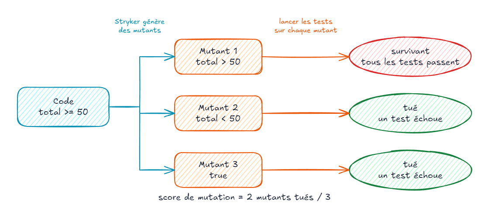
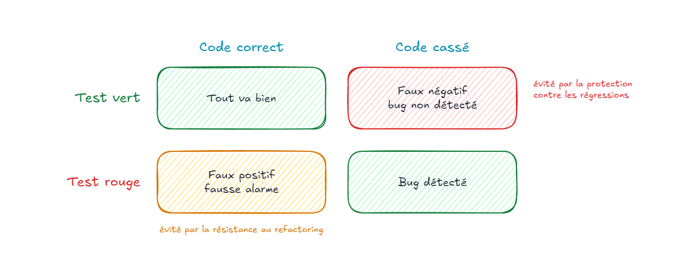
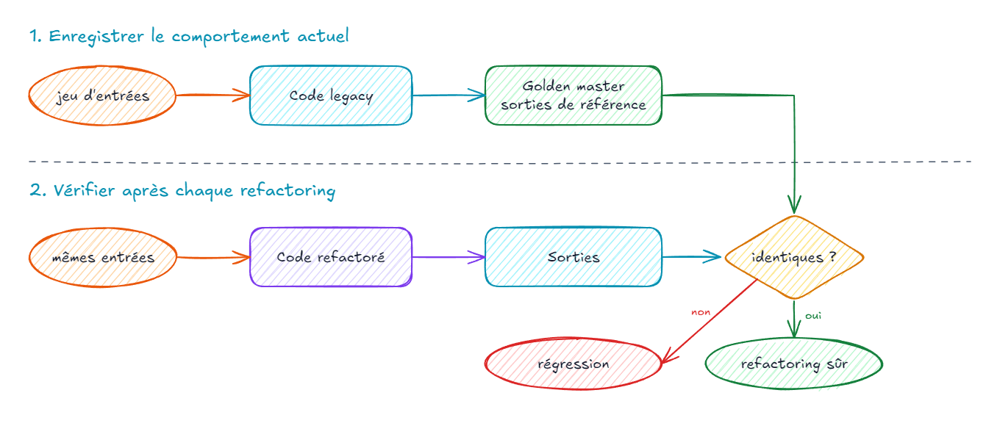
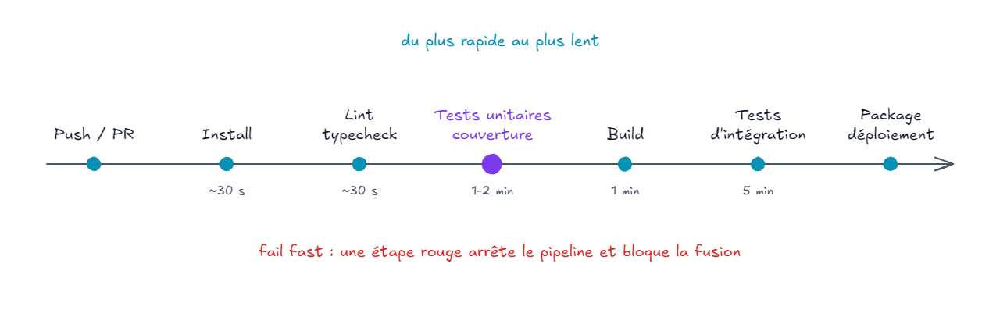

# Couverture, intégration continue, pièges et synthèse

---

#### Mesurer la couverture

- **Couverture de code** : part du code exécutée par les tests
- Mesurée par instrumentation pendant l'exécution 
- Révèle le code **jamais exécuté** par un test
- Ne dit **rien** sur la qualité des assertions

```bash
npx jest --coverage
```

---

#### Les métriques

| Métrique | Question posée |
|:--|:--|
| **Statements** | chaque instruction a-t-elle été exécutée ? |
| **Branches** | chaque branche (`if`, `? :`, `&&`, `||`) a-t-elle été prise ? |
| **Functions** | chaque fonction a-t-elle été appelée ? |
| **Lines** | chaque ligne a-t-elle été exécutée ? |

- **Branches** : la plus exigeante des quatre
- Rapport HTML détaillé dans `coverage/lcov-report/index.html`

---

#### Le rapport Jest

```ts
export function shippingCost(total: number, isPremium: boolean): number {
  if (isPremium || total >= 50) {
    return 0;
  }
  return 4.9;
}
```

```text
-------------|---------|----------|---------|---------|-------------------
File         | % Stmts | % Branch | % Funcs | % Lines | Uncovered Line #s
-------------|---------|----------|---------|---------|-------------------
 shipping.ts |     100 |      100 |     100 |     100 |
-------------|---------|----------|---------|---------|-------------------
```

- Testé avec un client premium et un panier de 20 € : **100 %**
- Le seuil de **50 €** n'a pourtant jamais été vérifié

---

#### Un seuil minimal

```js
// jest.config.js
module.exports = {
  preset: 'ts-jest',
  collectCoverageFrom: ['src/**/*.ts', '!src/**/*.test.ts'],
  coverageThreshold: {
    global: { branches: 80, functions: 80, lines: 80, statements: 80 },
  },
};
```

- `jest --coverage` **échoue** si le seuil n'est pas atteint
- `collectCoverageFrom` : compter aussi les fichiers **jamais importés** par un test
- Un **plancher** contre la régression, pas un objectif

---

#### Complexité cyclomatique

- Nombre de **chemins indépendants** dans une fonction (McCabe, 1976)
- 1 + nombre de décisions (`if`, `case`, `&&`, `||`, boucles…)
- **Minimum** de tests pour couvrir toutes les branches
- Au-delà de **10** : fonction difficile à comprendre et à tester
- La limiter avec ESLint : `complexity: ['error', 10]`

---

#### L'illusion du 100 %

```ts
it('calcule les frais de livraison', () => {
  shippingCost(20, false);
  shippingCost(20, true);
});
```

- **100 %** de couverture… et **aucune** assertion
- La couverture mesure ce qui est **exécuté**, pas ce qui est **vérifié**
- Le test ne peut **jamais** échouer : c'est un *Liar*

---

#### Ce que dit la couverture

- 🔻 Couverture **faible** : signal fiable, du code n'est pas testé
- 🔺 Couverture **élevée** : ne prouve **rien** sur la qualité des tests
- 🎯 En faire un **objectif** pousse aux tests sans valeur (loi de Goodhart)
- 🔍 L'utiliser comme **outil d'exploration** : quelles zones à risque ne sont pas testées ?
- ✅ Viser une couverture élevée **du code métier**, pas de la plomberie

---

#### Le mutation testing



---

#### Le mutation testing

- Introduire de petits **bugs** (mutants) dans le code de production
- Relancer les tests pour **chaque** mutant
- **Tué** : au moins un test échoue, les tests protègent ce code
- **Survivant** : tous les tests passent, la modification n'est pas détectée
- **Score de mutation** = mutants tués / mutants générés
- Mesure la **qualité** des tests, là où la couverture mesure leur étendue

---

#### Stryker

```bash
npm install --save-dev @stryker-mutator/core @stryker-mutator/jest-runner
npx stryker init
npx stryker run
```

```json
{
  "testRunner": "jest",
  "mutate": ["src/**/*.ts", "!src/**/*.test.ts"],
  "reporters": ["clear-text", "html"],
  "coverageAnalysis": "perTest"
}
```

- Équivalents : **PIT** (Java), **mutmut** (Python), Stryker.NET (C#)

---

#### Des mutants survivants

```text
[Survived] EqualityOperator
src/shipping.ts:2:20
-     if (isPremium || total >= 50) {
+     if (isPremium || total > 50) {
Tests ran:
    shippingCost est de 4,90 € en dessous de 50 €

-------------|------------------|----------|-----------|------------|
             | % Mutation score |          |           |            |
File         |  total | covered | # killed | # survived | # no cov |
-------------|--------|---------|----------|------------|----------|
 shipping.ts |  73.68 |   73.68 |       14 |          5 |        0 |
```

- **100 %** de couverture, mais **73 %** de score de mutation
- Le mutant `>=` → `>` survit : la **borne** de 50 € n'est pas testée

---

#### Tuer le mutant

```ts {2}
it.each([
  [50, 0],
  [49.99, 4.9],
])('un panier de %d € coûte %d € de livraison', (total, expected) => {
  expect(shippingCost(total, false)).toBe(expected);
});
```

- Chaque survivant pointe un **cas manquant**, souvent une **borne**
- Mutation testing : lent, à lancer sur le **code critique** ou en **incrémental**
- Certains mutants sont **équivalents** (même comportement) : les ignorer

---

#### Faux positifs, faux négatifs



---

#### Faux positifs, faux négatifs

- **Faux positif** : le test échoue alors que le code fonctionne
  - fausse alarme, souvent après un refactoring ; la confiance dans les tests s'érode
- **Faux négatif** : le test passe alors que le code est cassé
  - bug non détecté ; assertions faibles ou absentes
- Protection contre les régressions ↘ faux négatifs
- Résistance au refactoring ↘ faux positifs
- ⚠️ Le vocabulaire varie : préciser « fausse alarme » ou « bug non détecté »

---

#### Les tests fragiles

- Un test **fragile** casse sans que le comportement ait changé
- Cause principale : le **couplage à l'implémentation**
  - vérifier des appels internes, l'ordre des appels, des détails de structure
  - tester des méthodes privées
  - recopier l'algorithme dans le test
- Symptôme : chaque refactoring **réécrit** les tests
- Remède : vérifier le **résultat observable**, pas le chemin pour l'obtenir

---

#### Couplé à l'implémentation

```ts
// ❌ Vérifie COMMENT le prix est calculé
it('calcule le total', () => {
  const calculator = new PriceCalculator();
  const applyDiscount = jest.spyOn(calculator as any, 'applyDiscount');

  calculator.total([{ label: 'Clavier', price: 120 }]);

  expect(applyDiscount).toHaveBeenCalledWith(120, 0.1);
});
```

```ts
// ✅ Vérifie CE QUE fait le calcul
it('applique 10 % de remise au-delà de 100 €', () => {
  expect(new PriceCalculator().total([{ label: 'Clavier', price: 120 }])).toBe(108);
});
```

---

#### Et les méthodes privées ?

- **Ne pas** les tester directement : ce sont des détails d'implémentation
- Les couvrir via l'**API publique** qui les utilise
- Méthode privée trop complexe pour être testée ainsi : signe d'une **classe cachée**
  - l'**extraire** dans sa propre classe, avec une API publique testable
- ❌ Ne pas rendre public « juste pour le test »
- ❌ Pas de `as any` pour atteindre un membre privé

---

#### Surspécification

```ts
// ❌ Fige toute la structure : un nouveau champ casse le test
expect(invoice).toEqual({
  id: 'F-2026-001', createdAt: new Date('2026-01-01'), currency: 'EUR',
  lines: [{ label: 'Clavier', price: 120 }], total: 108, shipping: 0,
});
```

```ts
// ✅ Vérifie ce que le test raconte
expect(invoice).toMatchObject({ total: 108, shipping: 0 });
```

- Un test = **un comportement** : n'asserter que ce qui le décrit
- Même piège avec les **snapshots** géants validés sans les lire

---

#### Les tests instables

| Cause | Remède |
|:--|:--|
| Heure, date | horloge injectée, fake timers |
| Hasard | générateur injecté, `spyOn(Math, 'random')` |
| Ordre des tests, état partagé | état recréé dans chaque test |
| Promesse non attendue | `await`, `expect.assertions(n)` |
| Réseau, base, fichiers | doublures en test unitaire |

- **Flaky test** : passe ou échoue sans changement de code
- Un test instable **ignoré** une fois l'est ensuite toujours : le corriger ou le supprimer

---

#### État partagé

```ts
// ❌ Le panier est partagé : le résultat dépend de l'ordre des tests
const cart = new Cart([]);

it('ajoute un article', () => {
  cart.add({ label: 'Clavier', price: 120 });
  expect(cart.itemCount()).toBe(1);
});

it('démarre vide', () => {
  expect(cart.itemCount()).toBe(0);
});
```

- Créer l'objet **dans** chaque test (ou dans un `beforeEach`)
- `jest --randomize` : mélanger l'ordre pour révéler ces dépendances

---

#### Anti-patterns

| Anti-pattern | Symptôme | Remède |
|:--|:--|:--|
| **Excessive setup** | des dizaines de lignes d'Arrange | builders, revoir la conception |
| **The Giant** | un test vérifie tout | un comportement par test |
| **The Liar** | ne peut jamais échouer | voir le test **rouge** au moins une fois |
| **The Inspector** | viole l'encapsulation | tester via l'API publique |
| **The Slow Poke** | prend des secondes | doublures, isoler les I/O |

---

#### The Liar

```ts
// ❌ L'événement est émis après la fin du test : l'assertion ne s'exécute jamais
it('notifie le client', () => {
  orderEvents.on('confirmed', (order) => expect(order.status).toBe('confirmed'));

  checkout.confirm(cart);
});
```

```ts
// ✅ Le test attend l'événement et échoue si l'assertion n'est pas exécutée
it('notifie le client', async () => {
  expect.assertions(1);
  const confirmed = new Promise<Order>((resolve) => orderEvents.once('confirmed', resolve));

  await checkout.confirm(cart);

  expect((await confirmed).status).toBe('confirmed');
});
```

---

#### Le code legacy

> Le code legacy, c'est du code sans tests.
>
> — Michael Feathers, *Working Effectively with Legacy Code*

- Le **dilemme** : pour modifier en sécurité, il faut des tests…
- … et pour ajouter des tests, il faut souvent modifier le code
- Avancer par **petites étapes sûres**, refactorings automatisés de l'IDE

---

#### Modifier du legacy

1. Identifier les **points de changement**
2. Trouver les **points de test** : où observer le comportement ?
3. **Casser les dépendances** qui empêchent de tester
4. Écrire des **tests de caractérisation**
5. **Modifier** et **refactorer**, en TDD pour le nouveau code

— Michael Feathers

---

#### Golden master



---

#### Golden master

- **Test de caractérisation** : figer le comportement **actuel**, bugs compris
- Générer un **grand jeu d'entrées** couvrant le code à refactorer
- **Enregistrer** les sorties produites par le code existant (le golden master)
- Vérifier que chaque refactoring produit **exactement** les mêmes sorties
- Remplacer progressivement par de vrais tests unitaires, puis **supprimer** le golden master

---

#### Approval testing avec Jest

```ts
const types = ['jour', 'nuit'];
const ages = [0, 5, 6, 17, 18, 64, 65];
const days = ['lundi', 'samedi'];

it('caractérise le calcul de prix existant', () => {
  const results = types.flatMap((type) =>
    ages.flatMap((age) =>
      days.map((day) => `${type} | ${age} ans | ${day} → ${legacyPrice(type, age, day)}`),
    ),
  );

  expect(results).toMatchSnapshot();
});
```

- 1er lancement : écrit `__snapshots__/*.snap` ; ensuite : compare
- Combinaisons d'entrées → **couverture** et **mutation testing** pour valider le filet

---

#### Snapshots : bon usage

- Le snapshot est **relu** et commité comme du code
- `jest -u` met à jour : seulement pour un changement **voulu**
- Idéal pour le **legacy** et les sorties volumineuses (rapports, sérialisation)
- ⚠️ Pas pour remplacer des assertions ciblées en TDD
- ⚠️ Snapshot géant = personne ne le lit = test qui valide tout

---

#### Casser les dépendances

- **Seam** (couture) : endroit où changer un comportement **sans** modifier le code à cet endroit
- **Paramètre** : passer la dépendance au lieu de la créer
- **Extract and override** : extraire l'appel dans une méthode, la surcharger en test
- **Extraire une interface** : injecter une doublure
- Les techniques du jour 2, appliquées **avec prudence** sur du code non testé

---

#### Sprout et wrap

- **Sprout method / class** : écrire le **nouveau** code à part, en TDD, puis l'appeler depuis le legacy
- **Wrap method / class** : envelopper l'existant pour ajouter un comportement avant ou après
- Le legacy reste **intact** ; le nouveau code est **testé**

```ts
export function legacyCheckout(cart: LegacyCart): number {
  // … 200 lignes non testées …
  const total = computeLegacyTotal(cart);
  return applyLoyaltyDiscount(total, cart.customer); // 🌱 nouveau, testé en TDD
}
```

---

#### Parallel change


- Changer une interface **sans tout casser** d'un coup
- Ancienne et nouvelle versions **coexistent** pendant la migration
- Les tests restent **verts** à chaque étape ; chaque étape peut être commitée

---

#### L'intégration continue

- **Intégrer** son code à la branche principale **souvent** (au moins une fois par jour)
- Chaque intégration est **vérifiée automatiquement** : build, tests, qualité
- 🔔 Régressions détectées en **minutes**, pas en recette
- 🤝 Une branche principale **toujours** dans un état livrable
- 📈 Métriques suivies dans le temps

---

#### Le pipeline



- Les tests unitaires tournent **tôt** : retour en quelques minutes

---

#### Quality gates

- **Tests** : 100 % de tests verts, sans exception
- **Couverture** : seuil minimal (`coverageThreshold`), ou pas de baisse
- **Analyse statique** : lint, typecheck, SonarQube (*clean as you code*)
- **Mutation** : score minimal sur le code critique (Stryker `thresholds.break`)
- Rendues **obligatoires** : branch protection sur la PR
- Appliquer d'abord au **nouveau code** plutôt qu'à tout le legacy

---

#### Garder un feedback rapide

- **Cache** des dépendances 
- **Paralléliser** 
- **Lancer d'abord** les tests impactés :
- **Séparer** tests unitaires (chaque push) et tests lents (merge, nuit)
- Objectif : un retour en **moins de 10 minutes**

---

#### Les outils de CI

| Outil | Fichier | Particularité |
|:--|:--|:--|
| **GitHub Actions** | `.github/workflows/*.yml` | intégré à GitHub, marketplace |
| **GitLab CI** | `.gitlab-ci.yml` | rapports JUnit et couverture dans la MR |
| **Jenkins** | `Jenkinsfile` | auto-hébergé, très extensible |
| **Azure DevOps** | `azure-pipelines.yml` | écosystème Microsoft |

- Mêmes **étapes**, mêmes **principes** : seule la syntaxe change

---

#### Par langage

| | Java | Python | JS / TS |
|:--|:--|:--|:--|
| Rapport de tests | Surefire (JUnit XML) | `pytest --junitxml` | jest-junit |
| Couverture | JaCoCo | coverage.py, pytest-cov | Istanbul, V8 |
| Mutation | PIT | mutmut | Stryker |
| Analyse statique | SonarQube, SpotBugs | SonarQube, ruff | SonarQube, ESLint |

- Les **concepts** sont identiques : seuls les outils changent

---

#### À retenir

- 100 % de couverture ne prouve **rien** : vérifier la qualité des tests (mutation)
- Tester le **comportement observable**, jamais l'implémentation
- Corriger ou supprimer les tests **instables**, ne pas les ignorer
- Sur du **legacy** : golden master d'abord, refactoring ensuite
- Une **CI** rapide et bloquante rend les tests utiles au quotidien
